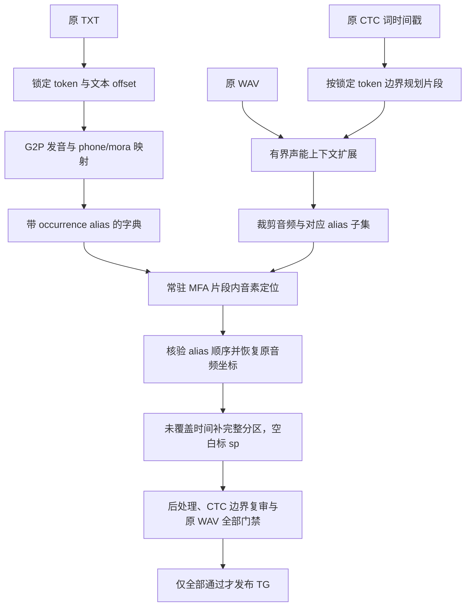

# JapGalgame 分时间戳 MFA：有声区被标成 sp 的分析与修复交接方案

> **For agentic workers:** 使用 `superpowers:executing-plans` 在获得修复执行指令后逐项实施。本文是分析与条件化修复方案，本次仅写文档；不要因读到本文就修改生产、启动重放或重新启用自动消息。步骤用复选框跟踪，未勾选表示未执行。

**Goal:** 修复“原音频有语音，但分时间戳 MFA 未正确覆盖、最后标成 sp”的问题，同时保持原文、正确音素所有权、严格最终审核和常驻处理速度。

**Architecture:** 保持当前 CTC 切段、常驻 MFA、批量准备及自动发布结构。先沿原输入和原始输出区分切段未覆盖、MFA 片段内部错位、发音映射失败和短边界审核问题；只对有证据的失败源生成有界候选，候选经完整最终审核后才能替换失败结果。原来正确的输入与已发布成品不能因修复被无条件重跑或改写。

**Tech Stack:** Python、Qwen3-ForcedAligner 的已有 CTC TextGrid、日语 frontend/G2P、MFA/Kalpy 原生 GMM 对齐、tdmelodic、SQLite、常驻本地 socket、原 WAV 声能审核。

**Spec:** 本文第 1–9 节为问题证据、设计依据和约束，第 10–13 节为实施与验收安排；配套冻结证据见第 14 节。

文档日期：2026-10-03。冻结时刻：**2026-10-03 08:46:38 UTC / 16:46:38 中国标准时间**。全部运行数值、PID、SHA 是该时刻附近的快照，新对话必须重新核验。结论适用于已有明确证据的样本，不代表全语料的人工音素真值。

## 1. 交接目标与本次实际完成范围

用户连续报告：试听中的多个被筛除样本存在明显说话声，却在对应时间被标为 sp；询问是词没有正确转成音素，还是时间戳和音素位置没有对应上。当前请求是**完整分析、设计可能的解决方案、保存文档，交给新对话执行修复**。

本次执行了：读取现有代码、十条样本的已有证据、单个原模型数据库记录、状态和文件 SHA；保存本方案与冻结证据。没有运行新的 MFA、重新生成图或特征，没有修改生产代码、模型、参数、质量门禁、源三联、已发布 TextGrid 或进度数据库，也没有重启/暂停生产。

新对话的完成标准是：定位并修复至少一个已证明的问题机制，经过真实样本与正常对照的完整验证，安全集成并确认常驻生产实际使用新版本；无法可靠修复的样本保留明确失败及未知原因。不得用“通过率变高”代替正确性证明。

## 2. 必须遵守的边界

1. 所有远程操作通过 `ssh user@192.168.102.108`，工作目录 `/home/user/JapanMFA`；先读该目录 `AGENTS.md`。保存所有既有未提交和未跟踪修改，不可 `reset --hard`、覆盖为 Git HEAD 或清理 `.runtime`。
2. 源 `/mnt/Raw/JapGalgame` 中 WAV/TXT/CTC 不可修改；原文与说话人关系不可通过听音、ASR、文件名或推测补造。没有证据的读音、声调、音素不能发明。
3. 成品 `/mnt/Raw/GalgameMFA/<游戏>/<原相对路径>.TextGrid` 仅允许管线最终停顿、声能、标点、五轨、SHA、源配对全部通过的 TG；filtered/failed/准备成功/decoder 成功均不是 passed。
4. 质量门禁不删减、不放宽；不要把长段 sp 直接涂改为音素，不均匀拉伸音素来迎合 CTC，也不把有能量一律解释成语音。自动审核不等于人工音素真值。
5. 当前脚本自行处理，无助手逐条或逐批审批环节。不要把人工 LLM 审核串进生产热路径。
6. 自动消息任务 `japgalgame-ctc-mfa` 保持 **PAUSED**，用户没有授权重新启用；健康生产继续运行。不要因新对话启动而恢复通知或重复启动 MFA。
7. 私有验证使用独立 root/cache/socket/输出目录；不能复用、关闭或占用生产 resident socket，也不操作其他聊天的作业。
8. 对齐问题沿用 `/home/user/JapanMFA/docs/alignment-issues.md` 单一历史问题账本。新增问题、复发、修复和限制追加证据，不能抹去历史未知根因。本文是交接入口，不能替代该账本。
9. 本文不授权现在改写历史已发布成品。后续若确需更正，须先保留原产物和 SHA，并遵循 AGENTS 的审核与回滚流程。

## 3. 当前生产状态：与早期一小时/500 的版本区分

冻结快照：

| 项目 | 冻结值 / 含义 |
|---|---|
| Git HEAD | `b1fdf2708044e6e5e5b3a290420679c186431fac`，大量 dirty/untracked 修改，HEAD 不是完整生产版本 |
| 主进程 / scanner | `2013962` / `2013963`；启动 ticks `611661792` / `611661801` |
| 原生对齐常驻进程 | `2013695`，启动 ticks `611661610` |
| 准备常驻进程 | `2013696`，启动 ticks `611661610` |
| 本地证据 watcher | `2014027`，启动 ticks `611661823` |
| MFA 当前阶段 | `running / after-ctc-complete`，`error=null` |
| MFA 累计 | `72766 passed / 205296 filtered`；是快照，不是全量完成 |
| CTC | `complete_with_failures`：`6421468 success / 1640 failed / 6423108 paired / remaining=0 / 16 workers_complete` |
| 准备窗口 / 声学组 | 2000 源准备窗口，内部仍保留 4 个 500 源声学组 |
| 常驻模型 | 对齐状态 `model_loads=2`，准备状态 `g2p_loads=1`；模型加载数不是每批增长 |
| 代码核验 | 本次 77 项生产 SHA 与已部署准备优化记录逐项相同，漂移 0 |
| 历史生产回归 | `763 passed / 15 real_models deselected in 22.22s`，不是本次重新运行，也不是声学真值验收 |

两类独立 root：

- 对齐：`/home/user/JapanMFA/.runtime/mfa-root-galgame-all`
- 准备：`/home/user/JapanMFA/.runtime/mfa-root-galgame-preparation`
- 对齐实际 temporary_directory 位于本作业 `work/<窗口>/run/batch-timed/<组>/work` 内，不能只比较环境 root 字面值；新对话须读取实际参数。

当前启动入口：`/home/user/JapanMFA/.runtime/jobs/galgame-mfa-all/resume-timed-resident.sh`。准备 8 worker、2000 窗口、前取和完整词请求缓存已部署。早期 52–55 分钟/500 属于旧的逐源启动 G2P/声调版本，不能作为当前速度。

本次问题窗口 `e4c192e450754ac89d3b0c14baf89363` 的真实内层报告：2000 源，准备 30.2864s、MFA 93.3220s、timed review 111.4377s、发布 13.1667s，总计 248.2127s；344 通过、1656 筛除。平均折合约 62.05s/500 **仅是该报告内层时间**，不等于纯 MFA 时间、全程吞吐或未来 ETA。

`heartbeat-latest.json` 是含历史字段的累计文档，顶层旧 PID/旧计数/旧“待应用”信息不能优先于实时状态和最新部署回执。`available-ctc.log` 末尾包含历史旧版本错误，当前运行阶段读 `after-ctc-complete.log`。日志旧错误不直接意味着当前故障。

## 4. 现行管线如何产生 sp



关键区别：

- **G2P 是符号转换**，生成发音序列，不在转换时把每个音素放到某个时间戳。
- **CTC 是片段规划的时间参考**。当前约束主要通过切片和片段两端审计实现；片段内每个词/音素的定位由 MFA 决定，并没有把全部 CTC 词边界作为 decoder 的逐词硬约束。
- MFA 完成后，按 `start_frame / sample_rate` 恢复全局坐标。代码有 alias 全覆盖及 crop 越界检查，但这些不证明声学定位正确。
- `complete_phone_partition` 把没有音素覆盖的时间补成 silence，之后命名 sp。它保证分区连续，**不能证明被补的区域实际安静**；原 WAV 能量门禁必须继续检查。
- 标点投影发生在已有 word/phone 几何之后。已有间隙可以显示源标点；没有间隙时标点记为 unplaced，不会将已对齐的语音音素改成静音。
- sp 是标签，不是音频处理动作；试听的原音频没有被消音。

### 4.1 已核对代码位置（行号基于当前 SHA，未来须重定位）

| 文件（均相对 `/home/user/JapanMFA`） | 入口 / 当前行号 | 责任 |
|---|---|---|
| `src/japanmfa/mfa/timed.py` | `plan_timed_segments:32` | 锁定原文/token/CTC 字流一致；长停顿与可用 token 边界切段 |
| 同上 | `expand_timed_segments_with_audio:131` | 用声能进行有界上下文扩展，保留原 anchor |
| 同上 | `align_timed_segments:281` | crop、子集 alias、解析 native 输出、恢复全局坐标 |
| 同上 | `audit_timed_alignment:349` | 与原 CTC anchor 比较片段首尾偏移 |
| `src/japanmfa/mfa/hybrid_batch.py` | `build_batch_corpus:90`；`BatchGridRunner:185` | 批量 crop/全局 alias；按 utterance/segment 精确水合、本地 alias 恢复及 crop SHA 核验 |
| `tools/galgame_mfa_hybrid.py` | `run_timed_batch:238` | 准备窗口内的 500 声学组、复审与发布 |
| `src/japanmfa/pipeline.py` | `review_mfa_inputs:815`；postprocess 调用 `1213` | 复用准备身份，原生对齐结果经过完整后处理 |
| `src/japanmfa/mfa/timing_review.py` | `review_processed_timing` | 原始/最终边界分开审计；只允许有完全安静证据的 inward anchor trim，不清除已有声学失败 |
| `src/japanmfa/output/textgrid.py` | `complete_phone_partition:356`；`build_word_intervals:549` | 补未覆盖区间；向已有间隙投影标点 |
| `src/japanmfa/postprocess.py` | `_pause_acoustic_coverage:613`；`postprocess_annotations:1096` | 原 WAV 停顿内能量冲突、有限边界修整、最终失败理由 |
| `src/japanmfa/mfa/failed_retry.py` | `wrap_compiled_alignment:11` | 仅 native 10/40 不成功时追加 10/160 |
| `src/japanmfa/mfa/native_resident.py` | `serve:60` | 常驻模型与进程内失败重试 wrapper |
| `tools/galgame_mfa_all.py` | `_commit_batch:235`；`run_all:302` | 同一 SQLite 的源签名、终态、提交与后续数据扫描 |

切段默认值：`min_segment_duration=0.6s`、`min_gap=0.4s`；极短 crop `<0.25s` 会在相邻边界范围内补上下文。小间隙并不必然消失：原 CTC start/end、声能扩展停止点和相邻分段仍可能留下未覆盖范围。不能仅因为有 `min_gap` 就认为所有较小间隙都会被合并。

## 5. 低通过率的分项事实

窗口 `e4c192e450754ac89d3b0c14baf89363`：

| 唯一最终理由 | 条数 | 可确认的含义 |
|---|---:|---|
| `alignment_acoustic_coverage` | 1259 | 当前音素/停顿几何与原 WAV 声能覆盖冲突；不等于这些源音频质量差 |
| `no_mappable_pronunciation` | 250 | 发音与严格 phone/mora 所有权无法完整映射，是独立的准备失败类别 |
| `timestamp_mfa_disagreement` | 112 | 最终音素所有权与原 CTC 参考明显不一致 |
| `unsupported_japanese_text` | 15 | 现有 frontend 支持限制 |
| `malformed_output` | 10 | 输出格式/结构无法通过严格验证 |
| `bgm_suspect` | 6 | 背景声怀疑，需要区分语音与非语音，不能以音量代替语义判定 |
| `phone_in_silence` | 3 | 音素落在被检测为安静的位置 |
| `missing_output` | 1 | 缺失原生输出 |
| **合计** | **1656** | 与 344 passed 合计 2000 |

对 1259 份已有本地 postprocess 报告的读取：1257 有 suspect pause，904 的 pause 活跃能量累计至少 0.2s，73 只有不超过 0.04s 的短边缘冲突，111 有 unowned region，513 有 synthetic silence region。这些诊断**相互重叠，不可相加为最终数量**；904 的能量证据也不是 904 条已经人工确认的遗漏语音。

前一窗口 `35816974639144248d1614e5d9aa341b` 为 499/2000 通过，映射拒绝 121；本窗口通过减少 155，其中映射拒绝增 129、声能覆盖拒绝增 30。源批次内容不同，不能据这两个窗口认定准备提速造成质量下降。

必须保留多个诊断与原始/最终理由。某条已存在声学失败时，后续 timestamp audit 不一定替换顶层 reason；不能只按一个 reason 看不到另一种异常。旧混合管线还可能由 SQLite 的 whole_reason 优先遮蔽最终 anchored_reason；新 timed 结果优先查完整报告的 `timed_reason` 及 postprocess，而非只看账本短字符串。

## 6. 十条试听样本的精确证据

全部来自 `ASa_Project_Karigurashi_Ren_ai`，完整源 key 为“游戏名/下表源名”。选样固定随机种子 `20261003`，7 条较长能量冲突、3 条短边界冲突，在各分层内随机抽取；**不是总体随机估计样本**。

| 序号 | 源名（不含扩展名） | stem | 页面主要冲突区间 / 来源 |
|---|---|---|---|
| 1 | `vo2_0821__ASa_Project_Karigurashi_Ren_ai` | `u07dbf7189e01ecd170edd1d0` | 0.77–1.76s：native silence 0.77–1.16、1.68–1.76；未覆盖 1.16–1.68 |
| 2 | `vo1_1999__ASa_Project_Karigurashi_Ren_ai` | `uabaf9ac814eeff92c79fb519` | 1.97–2.34s：均为 native silence，相邻 crop 没有空隙 |
| 3 | `vo2_0390__ASa_Project_Karigurashi_Ren_ai` | `u01ebfba0a38bcd38199798bc` | 1.25–1.60s：native 1.25–1.52；未覆盖 1.52–1.60 |
| 4 | `vo1_1846__ASa_Project_Karigurashi_Ren_ai` | `u5f63ebb03626529f122c5775` | 最终 0.88–2.969375s：native 0.88–2.57；未覆盖尾部 2.57–2.969375 |
| 5 | `vo2_1563__ASa_Project_Karigurashi_Ren_ai` | `u25f8c308c29f3d549bed7968` | 3.55–5.129375s：native 3.55–4.64；未覆盖尾部 4.64–5.129375 |
| 6 | `vo2_1301__ASa_Project_Karigurashi_Ren_ai` | `uf2185d00e25d0cf201965803` | 0–1.05s：未覆盖头部 0–0.48；native 0.48–1.05 |
| 7 | `vo1_2037__ASa_Project_Karigurashi_Ren_ai` | `u8f7edc7d107f9848360bff85` | 1.01–1.67s：native 1.01–1.04、1.04–1.67，无切段空隙 |
| 8 | `vo1_1995__ASa_Project_Karigurashi_Ren_ai` | `u766bdffe7b6dab9c43bfab96` | 1.52–1.56s：native，活跃部分只有 0.03s |
| 9 | `vo2_0986__ASa_Project_Karigurashi_Ren_ai` | `udc0ca29b89456c501c3869ed` | 4.32–4.40s：完全是两 crop 之间未覆盖区，活跃部分 4.32–4.35 |
| 10 | `vo2_1514__ASa_Project_Karigurashi_Ren_ai` | `u3e4114e626ddc5d51abae8b9` | 4.00–4.08s：native，活跃部分只有 0.03s |

对页面主要冲突分类：**4 条 native-only / 5 条 native+gap / 1 条 gap-only**。同一源的其他冲突可能类型不同，表格不是整源全部异常分类。

试听按钮包含活跃范围前后各约 0.3s。用户已报告这些样本存在明显说话声，但听到上下文语音不能直接证明最后 3 条的准确 30ms 冲突区间一定含目标音素。先修复长段明确遗漏，再单独处理短边界。此前试听 5 条和本次 10 条均不能外推所有筛除正确或错误。

### 6.1 优先复现：第 4 句「タクマ。」

完整源 key：`ASa_Project_Karigurashi_Ren_ai/vo1_1846__ASa_Project_Karigurashi_Ren_ai`。

- 原 WAV：`/mnt/Raw/JapGalgame/ASa_Project_Karigurashi_Ren_ai/wav/vo1_1846__ASa_Project_Karigurashi_Ren_ai.wav`，时长 2.969375s。
- 原 TXT：同游戏 `txt/vo1_1846__ASa_Project_Karigurashi_Ren_ai.txt`；内容「タクマ。」及原换行。
- 原 CTC：同游戏 `ctc/vo1_1846__ASa_Project_Karigurashi_Ren_ai.TextGrid`；词 anchor 0.48–2.40s。
- frontend：唯一 token「タクマ」，reading「タクマ」，mora「タ/ク/マ」。
- 原准备字典：`jmfa_000000 t a k ɯ m a`。
- group 0 全局字典：`jmfa_001865 t a k ɯ m a`，完整六音素，无转换缺项证据。
- 实际 crop：0.48–2.57s，2.09s 长；manifest crop WAV SHA `cdd389f6bf7403bb2355953d8d4917a0270b6f07b5895ef4eb3351581ca815bf`。
- 原 native word：local 0.03–0.28s，对应原 WAV 0.51–0.76s。
- 六 native phone local：`t .03–.06 / a .06–.11 / k .11–.14 / ɯ .14–.17 / m .17–.20 / a .20–.28`。
- 原 native blank：local 0.28–2.09s，对应原 WAV **0.76–2.57s**。这段已经包含在输入 crop 内，无法仅靠消除 crop 间隙解释。
- 后处理仅把末音素从 0.76s 延到 0.88s，随后仍拒绝：最终 pause 0.88–2.969375s 中 active 1.32s、最长连续 active 1.24s。
- raw timestamp 差异：native 末边界相对 CTC 提前 1.64s；最终 phone owner 仍提前 1.52s。顶层理由保留 `alignment_acoustic_coverage`，并未因此消失 timestamp 证据。

原生数据库与日志的新增只读核验：group 0 `corpus.db`，file `b0189_000`，utterance/internal id **580**、Kaldi key **1-580**，209 feature frames；alignment likelihood **-63.38858309659091（非 NULL）**；日志有 `Processing 1-580`、`Retried 1-580`，整组 `Done 1446, errors on 0`。因此它不是此前“decoder 失败/缺导出”类别，而是**有输出、有完整音素、但时间覆盖明显异常的候选**。

speaker_id=1，speaker_name=`corpus`，CMVN 来自该批 corpus 的 `cmvn.ark`。这是实际批内归组事实；是否导致错位未证明。SNR -0.4436928 是模型基于自身错误 phone/silence 分区算出的指标，不能把它作为源音频坏或无语音的独立证明。

原始路径（必须选 group 0，其他组有同名文件）：

```text
/home/user/JapanMFA/.runtime/jobs/galgame-mfa-all/batch-evidence/e4c192e450754ac89d3b0c14baf89363/run/prepared/u5f63ebb03626529f122c5775/frontend.json
/home/user/JapanMFA/.runtime/jobs/galgame-mfa-all/batch-evidence/e4c192e450754ac89d3b0c14baf89363/run/prepared/u5f63ebb03626529f122c5775/asr.json
/home/user/JapanMFA/.runtime/jobs/galgame-mfa-all/batch-evidence/e4c192e450754ac89d3b0c14baf89363/run/prepared/u5f63ebb03626529f122c5775/mfa.json
/home/user/JapanMFA/.runtime/jobs/galgame-mfa-all/batch-evidence/e4c192e450754ac89d3b0c14baf89363/run/prepared/u5f63ebb03626529f122c5775/mfa/dictionary.dict
/home/user/JapanMFA/.runtime/jobs/galgame-mfa-all/batch-evidence/e4c192e450754ac89d3b0c14baf89363/run/batch-timed/0/manifest.json
/home/user/JapanMFA/.runtime/jobs/galgame-mfa-all/batch-evidence/e4c192e450754ac89d3b0c14baf89363/run/batch-timed/0/dictionary.dict
/home/user/JapanMFA/.runtime/jobs/galgame-mfa-all/batch-evidence/e4c192e450754ac89d3b0c14baf89363/run/batch-timed/0/aligned/b0189_000.TextGrid
/home/user/JapanMFA/.runtime/jobs/galgame-mfa-all/batch-evidence/e4c192e450754ac89d3b0c14baf89363/run/batch-timed/0/work/corpus/corpus.db
/home/user/JapanMFA/.runtime/jobs/galgame-mfa-all/batch-evidence/e4c192e450754ac89d3b0c14baf89363/run/batch-timed/0/work/corpus/alignment/log/align.1.log
/home/user/JapanMFA/.runtime/jobs/galgame-mfa-all/batch-evidence/e4c192e450754ac89d3b0c14baf89363/run/pipeline-timed/u5f63ebb03626529f122c5775/postprocess.json
```

原三联 SHA：

```text
WAV ce921c1e820172813ede1976ffcd81bb36dc7e2146162be364c0fa1e731320a6
TXT b5f2bf889936526c147f4ee5fe055a13ab7afd2905952bfd00192657acb4e59f
CTC 242387fdba83202e95c71dd0fb84a5cad9b19d09d4e3bb44231726931cd7af0a
```

### 6.2 第 9 句证明另一条链，但不证明长遗漏语音

上一 crop 结束 4.32s，下一 crop 从 4.40s 开始；中间没有 native phone 覆盖，也没有 native explicit silence。整句分区补全直接生成 silence。原 CTC 是「絶対」结束 4.32、「私」开始 4.40。这证明**切段未覆盖→补 sp** 的机制；其声能仅 30ms，不能当成长段语音遗漏的代表。

## 7. 已确认结论与尚待证明的原因

| 判断 | 状态 | 下一步证据要求 |
|---|---|---|
| 第 4 句词未转成音素所以 sp | 不支持；字典、raw TG 六音素齐全 | 不能据此修改 phone map 或猜读音 |
| 第 4 句片段内部定位错误 | 已定位异常所在阶段 | 精确原输入复现、波形/特征/图身份与正常对照，证明具体触发 |
| 有部分 sp 来自 crop 未覆盖 | 已确认 | 明确每个 gap 是真实安静、目标语音还是非词声音，再决定是否重规划 |
| 所有 sp 都因标点 | 不支持 | 已有几何后才投影标点；继续保留标点回归 |
| 全局坐标恢复算错 | 本次未发现直接证据，未全量排除 | 验证帧取整、源/working 时间轴、crop 实际样本、offset 恢复，检查整段是否整体偏移 |
| G2P/reading 与实际口语不符 | 其他样本仍可能，未确认 | 完整原 token/mora/G2P 请求和听音定位；有缺证就保留未知，不能改原 TXT |
| 音频与文本/crop 被错配 | 现有 SHA/alias 机制提供保护，尚未做全部逐帧身份证明 | 源三联→working waveform→crop→manifest→DB→graph key→TG 的准确绑定 |
| 极短上下文、可选 silence 路径、声学模型不匹配 | 候选假设 | 同原图/特征单变量对照，不能只看更高 likelihood |
| 统一 `corpus` 归组 / CMVN 影响 | 实际归组已见，因果未证 | 保留旧 CMVN/最终特征；只改明确的归组/归一化变量，且不可猜真实 speaker |
| 常驻实现残留状态/缓存造成对齐错位 | 未证明 | 私有冷 native 与私有常驻输入完全一致的序列实验，含失败后接正常输入的污染检查 |
| 短边界审核误报 | 对部分样本有待确认 | 帧与 pause 的实际交集、波形/人工细标、真实短遗漏负例；不先放宽阈值 |

还需注意报告措辞：第 4 句 postprocess 的 `blocked_upstream_capabilities` 提到部分 CTC 边界能力 unavailable，而后续 `review_processed_timing` 实际读取了 segments/anchors 并记录偏移。不能仅凭这段通用诊断文本认定整个管线“没传时间戳”；可以在修复中让报告区分“后处理未采用逐词边界修正”和“后续 audit 已采用 anchor”。

## 8. 既有修复能解决什么，不能解决什么

已部署失败后搜索策略：原 native `beam=10 / retry_beam=40` 若返回 successful，则原 tuple 原样返回；仅 unsuccessful 时追加 `10/160`，使用原 graph 的 pristine Copy、同 features/model，保留真实 per-frame 字段。

它针对的是历史缺 raw / 漏 alias 的内部不成功对齐，不是准备提速，也不是第 4 句这种原 native 已返回成功的声学错位。`Retried` 日志不能推导底层每次 beam 细节，但原音素输出及非 NULL likelihood 已足以说明它不会走“原调用 unsuccessful 才追加”的生产分支。

历史 `725e15df9d6b4b479fe3e6ad68820899`：完全保留的原 model/LDA/graph/features 验证过 1662 成功精确不变、14 失败恢复；完整原输入导出/最终门禁保留 223 原通过 TG SHA。**这是不同批次的证据，不能把它作为本次有声 sp 已修复的证明。**

不要直接全局加大 beam/retry、关掉 optional silence、改变 dither、按 CTC 均匀摊音素，或把旧失败后搜索补丁重复安装。原生 decoder successful 和更高 likelihood 都不是最终正确性标准。

## 9. 可能的解决方案与推荐顺序

### 9.1 方案 A：先补全可追溯分类，再做失败后的局部重规划（优先）

把区间来源作为诊断保留：`native_explicit_silence`、`uncovered_inter_crop`、`uncovered_leading/trailing`，与 active range、原 token/alias、CTC anchor、raw/final 边界关联。未覆盖时间仍可按现有格式补 silence，但在**内部报告**不得把它解释成“已确认静音”。先不改变生产 TG 标签或 gate。

对已失败源中的 crop gap：

1. 检查实际间隙是否属于目标词的连续声音，而不是呼吸、效果音、另一说话人或文本未覆盖的非词声音。
2. 有连续语音证据时，优先把相关相邻 token 片段合成一个连续 crop，在常驻 MFA 内重新定位这组锁定 alias。原 CTC anchor 保留为审计参考，原文、词序与字典不改。
3. 新 crop 的 token 集合必须恰好覆盖被替换的旧片段并集，不能 alias 重复/遗漏；新旧片段拼接不能时间重叠。其余未受影响 raw phone 结果保留。
4. leading/trailing 不能盲目扩成“整句全属于首末词”；只能对已有锁定 token 的声音上下文做有界扩展。无法确定音素所有权则继续失败。
5. 原 gap 确实安静时保留 sp；明确长停顿/独立声音必须继续保留分段。

优点：直接处理已证明的缺覆盖机制，保留分时间戳对齐，并可限制为失败后回退。限制：无法单独修复第 4 句片段内部错位；重新分段会改变 feature/CMVN，需真实对照。

### 9.2 方案 B：处理“decoder 成功但声学/时间覆盖失败”（必须独立验证）

触发依据应为完整后处理失败证据，而不是 decoder boolean：长 native silence 内存在持续原 WAV 能量，同时 raw/final word span 与锁定 CTC anchor 严重冲突。两者提供候选定位，不能自动宣判实际语音或正确边界。

先做原输入受控诊断，按证据选择一个最小策略，不能把下列所有变化一起部署：

- **输入错配或时轴错误成立**：修正 identity/offset/working WAV 绑定；无关边界和成功源保持精确不变。
- **缺上下文成立**：仅失败的局部片段与邻接 token 合并，或在已验证的连续声区内重新裁剪。第 4 句是单词单片段，邻接合并不适用；要先检验该 crop 的波形、特征和 silence 路径。
- **搜索或 silence 路径问题成立**：先在私有原 graph/features 上单变量测候选参数。原 decoder 已初次成功时，仅改 retry_beam 可能根本不进入重试路径；不得把一次 10/160 调用当通用修复。若需要改初始 beam 或图约束，只对已触发的失败候选试验，完整记录路径及所有门禁，禁止全局替换。
- **CMVN/归组问题成立**：保持原图与字典，隔离归一化变量；没有真实 speaker 身份时不能从 vo1/vo2/角色名猜 speaker。任何基于 utterance 独立归一化的提案须证明确实解决问题、保留正常对照，并标明改变了 feature 条件。
- **常驻状态污染成立**：修复请求隔离/生命周期；不回退为每源启动和加载模型。私有冷/热、连续请求、失败后下一请求都需要验证。

若有多个候选，不只按 likelihood 最大取胜。仅完整通过相同审核且所有权一致的候选可进入发布；两个候选边界明显矛盾而没有证据区分，记录不确定并保持失败。

### 9.3 方案 C：短边界精度与审核问题单独处理（后置）

最后 3 条主要冲突只有约 30ms。需确认 10ms 能量帧与实际 pause 的交集，避免把主要在相邻语音内的帧整段计为静音内语音。区间取整、最后不满一帧、相邻 phone owner、source pause 及最终 pause 的变化均需独立检查。

可先新增诊断区分部分帧/完整帧、邻接 edge/tail 与 detached island。只有在人工细标和合成正负例证明 gate 算法不正确时，才能提出计算修复；不通过把阈值整体提高或忽略 `<40ms` 间隙来提升通过率。真实短音、爆破、促音等仍须得到正确处理。

### 9.4 方案 D：250 条映射拒绝是独立任务，不能用 sp 修复绕过

逐个准备失败必须使用完整原 token/mora、COMPLETE 真实 G2P 请求及实际 adapter 身份：

- 如果是已证明合法而缺失的精确 phone/mora 规则，按既有映射修复流程添加最小规则和异常负例。
- 如果含缺音、插音、错误促音或未证明读音，继续拒绝。
- 准备恢复仅可唯一排入真实声学重试；不能计 passed。
- 不为解释第 4 句而改 map，因为该句字典和音素完整。

建议先完成 A/B 的长语音错位修复，C 独立排期；D 与声学错位隔离验证，避免混成一次无从归因的大改。

### 9.5 不采用的捷径

- 删除长段 sp 标签、把 gap 延给上一元音、按 CTC 时长线性拉伸整组 phone。
- 改 TXT 为听到的内容或用重新 ASR 输出替换权威 TXT。
- 全局增大 beam/retry、强制无 silence、改变 dither/模型/map 同时试验。
- 先放宽声能/时间戳门禁，再以“通过率恢复”证明修复。
- 对所有源反复整句重跑、每条重新加载、每批助手审批，或反复累计 NAS 全量读回。

## 10. 新对话执行顺序与文件责任

当前未实现任何新 sp 修复。以下为候选实施安排：先找因果证据，只有对应分支得到证明才进入编码。保持小范围，不重构准备优化模块。

### 任务 1：重核现场并冻结最小复现（只读开始）

- [ ] 读取本文、配套 JSON、远程 AGENTS 与 issue ledger；读取实时状态/PID/start ticks/socket root/当前 SHA。77 项冻结 SHA 发生漂移时先比较，不覆盖其他人的修改。
- [ ] 以十条源 key、原三联 SHA 和精确 group/manifest 定位原证据；检查旧 `work` 路径指向已清理目录时，改用 `batch-evidence` 同一相对路径，不当成缺证。
- [ ] 第 4 句逐层核对 source WAV、working waveform、sample rate、crop 精确帧、global/local alias、字典、数据库 internal key、原 graph/final features、模型/LDA 身份和 raw TG。源 WAV 相同 SHA 不自动证明 resample/crop 后时轴一致。
- [ ] 对需要写入/重放的模型 DB 只用私有副本；读活数据库通过只读 backup，保留已提交 WAL，不能复制不一致 DB 后做因果推断。
- [ ] 输出私有 `reproduction/receipt.json`：样本、输入 SHA、代码 SHA、真实参数、原/私有 root、成功/失败、缺证及限制；无账本信用。

拟创建本地诊断工具：`/home/user/JapanMFA/tools/diagnose_timed_sp.py`，**限定显式样本 manifest**，读取 retained report 和原输入身份，输出诊断 JSON，不扫描全部 NAS、不发布、不改 ledger。若短脚本已足够，可只保存在新的私有 stage，避免为一次诊断扩大工具接口。

### 任务 2：原 native 复现与单变量定位

- [ ] 用准确捕获的原 model/LDA/graph/final features 重放第 4 句及正常对照，记录原10/40结果与全部 vectors；先证明 baseline 能复现原错位。
- [ ] 区分已有原模型快照与当时实时 identity 验证：只存在 retained 文件不能追认原时刻 SHA。缺证就写 limitation；不能把另一个批次的身份验证搬过来。
- [ ] 从图路径、phone CTM、silence占用、逐帧特征、CMVN 和 likelihood 定位候选机制。每次只改一个变量；失败/无改善的实验原件也保留。
- [ ] 对“常驻污染”假设使用同一私有原输入顺序比较冷 native / resident 首次 / resident 重复 / 失败后正常输入；不要接入生产 socket。
- [ ] 对重新生成特征的实验另设 baseline：实际 dither 非零时 fresh 边界不一定逐值复现，不能把变化全部归因于修复。精确 retained 输入验证与 fresh 真实管线验证是两套证据。

如果 baseline 不复现或身份缺失，暂停该因果分支，先报告不确定；仍可执行有充分证据的 gap 诊断分支。不能预先保证具体 decoder/CMVN 根因。

### 任务 3：诊断来源和路由回归

拟修改：`src/japanmfa/mfa/timed.py`、`src/japanmfa/mfa/timing_review.py`；若输出诊断需串入 report，再最小修改 `pipeline.py`。默认不改 `output/textgrid.py` 的成品标签语义。

拟新增测试：`tests/unit/test_mfa_timed_recovery.py`。先写红灯验证下列断言，再做最小实现：

- [ ] 给出相邻 crop `[0,1.16]`、`[1.68,2.56]`，诊断准确返回未覆盖 `[1.16,1.68]`，不宣称真实静音，不改变输入 phone edges。
- [ ] 第 4 句 fixture 六 phone 齐全且 native blank `[.76,2.57]` 时，判为 native 内部覆盖冲突，不能判为 missing pronunciation；decoder success 不清除该问题。
- [ ] 原生空白与 synthetic gap 连续时两种来源分开保留，不能 double-count 整源终态。
- [ ] 安静 gap 保持 sp 且不触发盲目吸收；长安静停顿和独立声音不得被合并。
- [ ] 正常已通过源不进入 recovery；缺 alias、源 SHA 不一致、读音无法映射继续严格失败，不走声学补救旁路。

诊断记录建议至少包含：`source_key/stem/group/segment_index/token_range/aliases/original_anchor/original_crop/raw_word_span/raw_phone_span/native_silence_spans/uncovered_spans/active_ranges/raw_reason/final_reason/evidence_sha`。字段放内部报告，避免给产品引入未经证实的新音素标签。

### 任务 4：只实现已证明有效的一种局部 recovery

拟新增：`src/japanmfa/mfa/timed_recovery.py`（仅在需要可复用路由时），责任为候选 crop/token 规划、失败源路由及 candidate 验收，不能承担 G2P/声调更改。

可能的最小接入：`tools/galgame_mfa_hybrid.py::run_timed_batch`；候选仍经 `_batch_align` / `BatchGridRunner` 和 `review_mfa_inputs`，全部最终门禁不变。不重新写一套简化发布器。

- [ ] 先写 red tests：候选 token 并集精确、alias 一次覆盖、片段无重叠、未受影响片段保持原 raw、顺序正确、恢复 offset、失败仍失败。
- [ ] 以任务 2 已证明的机制决定使用局部合并、裁剪、identity修复或受控 decoder 候选。未证明的策略不实现为默认。
- [ ] 每源最多一次局部重规划及一次已验证的 decoder 候选为**初始资源上限提案**；如果最终只需一类，删去另一类。不得循环到通过，也不逐词启动新模型。
- [ ] 候选全部门禁通过才选取；审核失败保留原失败和 candidate 失败证据。不是使用 candidate 最高 likelihood 无条件覆盖。
- [ ] 原成功源完全绕过；失败源中非替换区域不得被偷偷均匀拉伸。fallback原/新 raw 与 final 差异可逐项定位。
- [ ] 坏请求后下一正常请求无缓存/字典/文本污染；模型按内容 cache identity 保留，不修改 installed Kalpy 或常驻模型文件。

### 任务 5：完整真实验证和对照

- [ ] 十条试听样本逐条验证，优先 1–7；8–10 单独标短边界证据状态。记录真实 passed/filtered，不能要求十条“必须全通过”而放宽门禁。
- [ ] 从同一原窗口选择安静停顿正常源、连续语音正常源、相邻短词/零时长 CTC 源、有效标点源、长停顿/非词声音负例、映射失败负例作为对照；记录选样规则，不只挑修复有利样本。
- [ ] 用一组完整 500 源保留输入做所有准备、水合、后处理、final-gate replay；只读原WAV，输出本地。原成功源集合和 TG SHA 在精确输入条件下应不变。若变化，逐源解释并停止部署，不能以“总通过数相同”交差。
- [ ] 另做一次完整真实 resident CLI 验证（图/特征新生成），确认实际代码路径与候选策略生效；fresh dither 不作为 exact SHA 对照。
- [ ] 运行局部及完整非真实模型回归，保留命令、版本、耗时、stdout/stderr。新测试增加后总数可能变化，不能硬编码仍然 763。

现有相关测试命令（将 cwd/PYTHONPATH 指向私有候选 checkout，不是默认在生产中跑实验）：

```bash
PYTHONPATH=src:. /home/user/JapanMFA/.runtime/envs/orchestrator/bin/python -m pytest -q \
  tests/unit/test_mfa_timed.py tests/unit/test_timing_review.py \
  tests/unit/test_galgame_timed_batch.py tests/unit/test_postprocess.py \
  tests/unit/test_output_textgrid.py tests/unit/test_projection.py \
  tests/unit/test_pause_audit.py tests/unit/test_native_resident.py

PYTHONPATH=src:. /home/user/JapanMFA/.runtime/envs/orchestrator/bin/python -m pytest -q -m 'not real_models'
```

新增 recovery 测试加入相关集；真正模型验证只跑已定义的私有验收任务，不因 15 deselected 就宣称完整声学验证完成。

最终原 WAV/TG 私有目录审核：

```bash
PYTHONPATH=src:. /home/user/JapanMFA/.runtime/envs/orchestrator/bin/python \
  tools/audit_textgrid_pauses.py <PRIVATE_FINAL_PAIR_DIRECTORY> \
  --output <PRIVATE_RECEIPT_DIRECTORY>/final-pause-audit.json
```

目录是私有产物，不能传 NAS 成品根做重复累计全量审计。候选失败的缺 TG 要记失败，不能在目录审核中被“没有文件”跳过后当成功。

### 任务 6：安全集成、实际生产确认和唯一重试

- [ ] 集成前原自己的 active child 退出，完整窗口报告归档，所有源账本落地；新的2000窗口/前取结构下不能把“暂时0个work目录”当充分安全间隙，要核对 scanner 子进程、resident 活跃请求和预取 worker。
- [ ] 常驻 Python 已加载的模块不会因磁盘文件替换自动更新。若修复涉及 native resident，需明确有界 drain/重启该自有 resident 的方案；若仅 orchestrator 子进程代码，也核对新请求加载版本。禁止在健康请求中途覆盖/重载。
- [ ] 完整 before SHA/内容/原 absence 备份与候选 SHA 保留；只安装自己修复文件，出现漂移先比较，禁止覆盖他人修改。
- [ ] 应用/必要恢复动作需由新对话的修复执行授权覆盖；失败回滚仅自己的文件及自有进程，finally恢复自己的 scanner，不能干扰别的任务。
- [ ] 实际生产相关/全回归、版本回执及真实新窗口观察通过后才标 applied；冻结 `startup-provenance.json` 不改写。
- [ ] 历史 retry 仅选与已证明修复范围一致的 `filtered` 源，完整最终理由、原请求/三联 SHA、同一 SQLite 唯一源状态齐全后排一次 `retry_required`。本次未读取全量 retry 状态，旧计数不能直接重复入队。
- [ ] 已 passed 源默认保持；没有原 evidence 的历史失败不能追认根因。新 queued 准备恢复或候选生成均不加声学通过信用。
- [ ] 脚本继续处理后续数据；监控保持轻量，自动通知仍暂停；无助手逐条审批。最终全部结束才依据完整结束报告报告终态、CTC失败1640范围和自动验证限制。

## 11. 验收条件与停止条件

| 维度 | 必须达到 | 不能作为验收的替代指标 |
|---|---|---|
| 原始身份 | 精确原三联、字典/token/alias、crop/waveform/frame axis、模型/LDA和图/特征身份可追溯 | 仅文件名相同、只比较同一个通过数 |
| 机制证明 | 原失败可复现，最小变量改变与效果对应；局限写清楚 | 其他批次成功、扩大搜索返回 true |
| 第4句 | 真实声音得到合理 native phone 所有权并通过完整门禁；若尚不能证明，保留失败与原因，不硬凑边界 | 把 0.76–2.57 直接延给 a，或改为不审核 |
| gap样本 | 有声 gap 通过合法重规划后交给 native 对齐；安静 gap 不被吞；无重叠/重复 alias | 删掉所有 sp、全面放宽gap限制 |
| 读音/声调 | 使用原合法请求，异常缺音/插音/促音继续拒绝 | ASR猜词/听音补TXT，统一改map |
| 正常对照 | 精确保留输入时原通过集合及未受影响 TG SHA 不变；无新漏字/停顿错误 | 总通过率不下降但换了一批源 |
| 真实运行 | 候选代码在常驻 CLI/worker内实际生效、全部自动审核通过 | 仅fake backend单测、仅准备成功 |
| 性能 | 前后比较同一固定源集、同cache状态/声学组，分别记录热身、准备、MFA、重试、复审、发布、外层E2E和内存；模型加载不按源/批反复增长 | 只报500纯MFA约半分钟、忽略回退代价 |
| 部署/重试 | 安全边界、可回滚、同账本唯一重试、无提前信用、源NAS未修改 | 双跑生产或对历史失败无限重试 |

性能初始警戒线提案：正常源路径固定集端到端中位数相对当前基线退化超过 10%，或失败多的固定集超过 25%，先调查并不推广；这些是工程预算，不是已测承诺。具体数值可按实际验收数据与用户要求调整，但不能通过移除审核达到。

没有预先设定“通过率必须达到X%”：不同游戏、权威TXT/实际音频、读音与声学模型条件不同。报告应分已修复错误、真实源不匹配、未支持文本、未知/缺证，而不是把所有filtered都解释为源质量差。

停止当前修复分支的条件：无法复现 baseline、关键 identity缺失、候选只是边界猜测、原通过对照退化、出现源SHA漂移、需要改变权威原文/猜真实speaker、生产版本被别人改动或不能取得本作业安全集成间隙。停止受影响分支并说明证据，不以扩大范围或放宽门禁硬推进。

## 12. 新对话需要特别避免的重复与误判

- 不重复已完成的 `725e` 原输入 decoder/export/final-gate 或早期性能实验来充当新的修复验证；复用其限制和技术方法即可。
- 不把 `e4c` 的 group 0 `b0189_000` 与 group 1/2/3 同名文件混淆；必须跟 manifest、utterance、segment绑定。
- 不直接checkout Git中的“旧正常版本”覆盖当前dirty实现。需要参考历史功能时用 `git show` 只读比较，当前分时间戳功能仍在运行。
- 不把 metadata中的 lexical字段叫“ASR确认的词正确”：CTC是在权威TXT上做强制对齐，字流一致不证明实际发音与TXT吻合。
- 不把非NULL likelihood、SNR、完整音素序列当边界真值；模型基于自身分区的质量指标可能随错误分区被污染。
- 不把 RMS/能量阈值当声学分类器；语音、呼吸、效果音、音乐仍需区分。
- 不因为 sp 是synthetic就忽略它：长段synthetic内遗漏语音是必须解决/拒绝的缺覆盖；也不能因为 sp是native就默认正确。
- 不因为 `heartbeat-latest`旧字段写待应用而重装已部署修复；当前代码77项SHA和生产最新回执优先。
- 不把500声学组与2000准备窗口混为一谈；扩大声学组会改变批上下文/CMVN，应是单独实验，不能当减少模型加载的必要动作。

## 13. 可直接交给新对话的执行说明

> 请先完整阅读 `/home/user/JapanMFA/docs/superpowers/plans/2026-10-03-japgalgame-timed-sp-repair-handoff.md` 和同目录 `2026-10-03-japgalgame-timed-sp-repair-evidence.json`，通过 SSH `user@192.168.102.108` 在 `/home/user/JapanMFA` 重核现场与 AGENTS。针对十条试听样本中的有声 sp 问题，从第4句 group0/internal580 的原输入和第1/9句 crop gap 机制开始，按本文区分已证明原因和假设，执行最小修复及完整私有真实验收。保留所有 dirty修改、原WAV/TXT/CTC、既有通过成品和门禁，保留常驻/批量准备/自动处理能力，安全间隙集成后只对确认受影响的失败源唯一排重试。不要重新启用自动消息、重复已有实验或加入逐条助手审批；每个结论必须附实际证据、通过/筛除/未知分类和限制。

上段用于用户在新对话明确发出修复任务，本次没有发送到任何其他聊天。

## 14. 完整证据与文档路径

### 14.1 本交接文件

主文档远程权威副本：

```text
/home/user/JapanMFA/docs/superpowers/plans/2026-10-03-japgalgame-timed-sp-repair-handoff.md
```

本地可点击副本：

```text
D:\Remote\docs\handoffs\2026-10-03-japgalgame-timed-sp-repair-handoff.md
```

配套冻结证据：

```text
/home/user/JapanMFA/docs/superpowers/plans/2026-10-03-japgalgame-timed-sp-repair-evidence.json
D:\Remote\docs\handoffs\2026-10-03-japgalgame-timed-sp-repair-evidence.json
SHA256 1cd986465f2abd8bb168198e779d124ce764422fb37223346ee0ccc32a77aca7
```

JSON包含冻结实时状态、PID/start ticks、原Git dirty清单、77项实际代码SHA、与部署SHA的零漂移对比、关键证据SHA、完整十条原文/source key/三联SHA、CTC crop及主要sp来源，以及第4句native DB记录。它是快照，不更新为实时状态。文档的原模型因果验证尚未完成。

### 14.2 原窗口和样本

```text
/home/user/JapanMFA/.runtime/jobs/galgame-mfa-all/batch-evidence/e4c192e450754ac89d3b0c14baf89363/run/hybrid-report.json
/home/user/JapanMFA/.runtime/jobs/galgame-mfa-all/batch-evidence/e4c192e450754ac89d3b0c14baf89363/pass-rate-explanation-20261003.json
/home/user/JapanMFA/.runtime/jobs/galgame-mfa-all/listening-samples-e4c192e-20261003/samples.json
/home/user/JapanMFA/.runtime/jobs/galgame-mfa-all/listening-samples-e4c192e-20261003/sp-origin-analysis.json
/home/user/JapanMFA/.runtime/jobs/galgame-mfa-all/listening-samples-e4c192e-20261003/listen.html
/home/user/JapanMFA/.runtime/jobs/galgame-mfa-all/listening-samples-e4c192e-20261003/01.wav … 10.wav
D:\Remote\artifacts\galgame-ten-failures-20261003\listen.html
```

手机同账号私有试听页面：
`https://galgame-ten-listening-oct03.dainty-lamp-8358.chatgpt.site`。无需为本修复创建或发布新Site。

### 14.3 已部署版本与历史方法回执

```text
/home/user/JapanMFA/AGENTS.md
/home/user/JapanMFA/docs/alignment-issues.md
/home/user/JapanMFA/.runtime/jobs/galgame-mfa-all/staged-preparation-optimization-20261003/plan.json
/home/user/JapanMFA/.runtime/jobs/galgame-mfa-all/staged-preparation-optimization-20261003/apply-receipt.json
/home/user/JapanMFA/.runtime/jobs/galgame-mfa-all/staged-preparation-optimization-20261003/production-regression.log
/home/user/JapanMFA/.runtime/jobs/galgame-mfa-all/staged-preparation-optimization-20261003/production-verification.json
/home/user/JapanMFA/.runtime/jobs/galgame-mfa-all/staged-failed-retry-search-repair/plan.json
/home/user/JapanMFA/.runtime/jobs/galgame-mfa-all/staged-failed-retry-search-repair/apply-receipt.json
/home/user/JapanMFA/.runtime/jobs/galgame-mfa-all/batch-evidence/725e15df9d6b4b479fe3e6ad68820899/retry-search-full-pipeline/
```

本次冻结的关键生产 SHA：

```text
src/japanmfa/mfa/timed.py              9324e757d4c322d27452c22a4b00e6d1be998021e33f74d6c263a0d48a4da272
src/japanmfa/mfa/hybrid_batch.py       b69308ba5e6dc69111a50545969c6ffc7656180ab52c18f0e79fe8e0606dbe84
src/japanmfa/mfa/native_resident.py    b259ea9b72260802d6c1daeed75dd8f3b78b4f6364a430585e053a246e5f15f4
src/japanmfa/mfa/failed_retry.py       df8f3f9185d5f8f163ca8b84e1856b95274b826ecb739b7f911ee5b118dc90b6
src/japanmfa/mfa/g2p.py                341038594169a84122e81cddabc7e38d97589050ae1b3255269b528039e37a01
src/japanmfa/pipeline.py               3f04ea34596ee419c1aa65f5aa23705f90edd7301ef70281f50484fa2e86ff58
src/japanmfa/postprocess.py            721e5eafd2f8b0b4eb726e58681596db623119f7a66d9c2fd095266d684b6211
src/japanmfa/output/textgrid.py        b18d4fc054d078672d2a061ed0fa86095fddfa07c519a13975411b56ade63f9f
tools/galgame_mfa_hybrid.py            0927019861f30d7662797d039d5abd56780bcbf05e2ce7e0afc197b3e91cd002
tools/galgame_mfa_all.py               4efe42e1e4feb9d6cb9f57a843339bb11f264ab69137581bcab1974176d6c7a6
```

完整77项以冻结JSON为准，不在新对话凭口述重新构造。最终交接状态：**问题阶段已有定位，具体 native 错位触发尚未证明；候选方案已设计，sp新修复尚未实施。**
